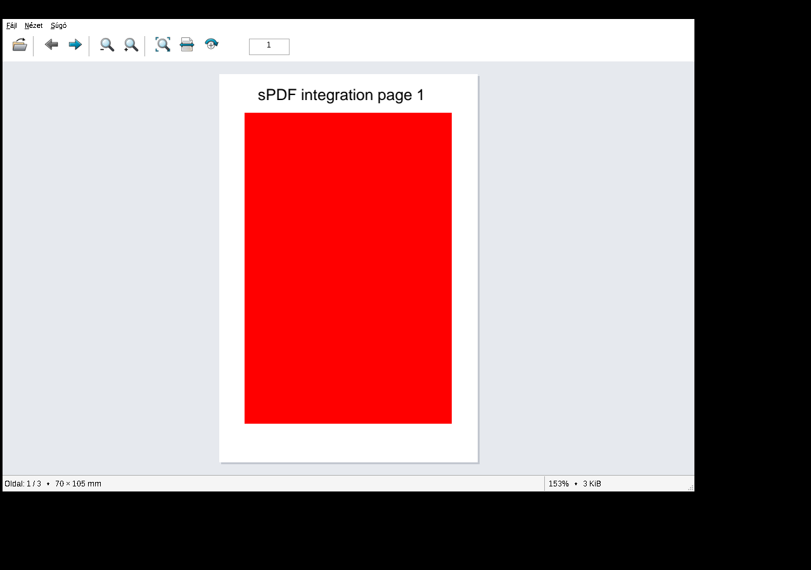

# sPDF Megtekintő

Könnyű, natív C++/Win32 PDF-megtekintő Windows x64 rendszerre. Magyar felület, PDFium motor, KDE Modern Classic ikonok; telepítés és .NET nélkül.

**0.1.0 előzetes – még nincs publikált GitHub Release.** Ez az első működő fejlesztői változat, nem a teljes 1.0 alkalmazás.

**Tervezett minimum: Windows 10 1607 (14393), x64. A kompatibilitás tényleges 1607 gépen még nem igazolt.** A keresztfordítás és a Wine-próba ezt nem helyettesíti.

## Letöltés és indítás

A helyben előállított ZIP: `dist/sPDF-0.1.0-preview-win-x64.zip`.

A [Windows x64 preview workflow](https://github.com/baloghim/sPDF/actions/workflows/windows.yml) sikeres futása után a ZIP a futás **Artifacts** részéből tölthető le. Manuálisan is indítható. A workflow csak a változások GitHubra kerülése után jelenik meg és fut le; helyi elkészítése nem jelent publikált artifactot.

Bontsa ki a ZIP-et, majd a benne lévő `sPDF` mappában indítsa az `sPDF.exe` fájlt. Az EXE és a `pdfium.dll` maradjon ugyanabban a mappában. Nincs telepítő vagy rendszergazdai jogosultságigény. A program nem végez telemetriát és futás közben nem tölt le függőségeket.

## Elkészült funkciók

- Egy PDF megnyitása fájlválasztóval, Ctrl+O-val, behúzással vagy parancssori fájlnévvel.
- Unicode-fájlnevek; jelszóval védett PDF-ek jelszókérése.
- Valódi, háttérszálon végzett PDFium-renderelés, igény szerint egy oldalról.
- Előző/következő/első/utolsó oldal és közvetlen oldalszám.
- Nagyítás, teljes oldal, oldalszélesség, 100% és görgetés.
- Ideiglenes, csak megjelenítést érintő 90°-os forgatás.
- Magyar menük, világos munkaterület, ikonos eszköztár, állapotsor, DPI-kezelés.
- Hibás, hiányzó, üres és 4 GiB-nál nagyobb fájlok elutasítása.

Az eredeti PDF-et a program kizárólag olvasásra nyitja meg; nem ír és nem szerkeszt PDF-et. Egyszerre **egy dokumentumot** kezel. Új fájl sikeres megnyitása lecseréli az előzőt; hiba esetén megőrzi azt. Több behúzott/parancssori fájlból az elsőt nyitja meg.



A képernyőkép a ténylegesen futó Windows EXE-ről, Wine és virtuális képernyő alatt készült; nem Windows 10 kompatibilitási bizonyíték.

**Még nincs:** dokumentumfül, folyamatos nézet, Oldalrendező, szövegkereső felület, PDF-export, nyomtatás, INI-beállításmentés, hivatalos Release, mért célhardver-teljesítmény.

## Billentyűparancsok

| Billentyű | Művelet |
|---|---|
| Ctrl+O / Ctrl+W | Megnyitás / dokumentum bezárása |
| PgUp / PgDn | Előző / következő oldal |
| Ctrl+Home / Ctrl+End | Első / utolsó oldal |
| Ctrl++ / Ctrl+- / Ctrl+görgő | Nagyítás / kicsinyítés |
| Enter az oldalszámmezőben | Ugrás az oldalra |
| F1 / Alt+F4 | Billentyűparancsok / kilépés |

## Fordítás Windows alatt

Visual Studio 2022 C++ desktop eszközök, Windows SDK, CMake 3.24+, x64 cél szükséges. A Python 3 csak a ZIP ellenőrzéséhez kell. Az ikonok már generált erőforrásként is a repóban vannak.

```powershell
cmake -S . -B build -A x64 -DBUILD_TESTING=ON
cmake --build build --config Release --parallel 2
ctest --test-dir build -C Release --output-on-failure --no-tests=error
cpack --config build/CPackConfig.cmake -C Release -B dist
python scripts/check-package.py dist/sPDF-0.1.0-preview-win-x64.zip
```

A CMake SHA-256 szerint ellenőrzi a rögzített Windows x64 PDFium archívumot. Offline: `-DSPDF_PDFIUM_ARCHIVE=C:/downloads/pdfium-win-x64.tgz`. Más verziót az ellenőrzés elutasít. A Visual C++ runtime statikusan kerül az EXE-be (`/MT`).

## Keresztfordítás Linuxon

Szükséges: MinGW-w64 x64 POSIX C++ fordító, windres, CMake és Ninja.

```sh
cmake -S . -B build-mingw -G Ninja \
  -DCMAKE_TOOLCHAIN_FILE=cmake/mingw-x64.cmake \
  -DCMAKE_BUILD_TYPE=Release -DBUILD_TESTING=ON
cmake --build build-mingw --parallel 2
cpack --config build-mingw/CPackConfig.cmake -B dist
python3 scripts/check-package.py dist/sPDF-0.1.0-preview-win-x64.zip
```

A Windows teszt-EXE Windows vagy Wine futtatókörnyezetet igényel; keresztfordításkor a CTest nem futtatja automatikusan Linux programként. A MinGW-build statikusan linkeli a GCC, C++ és winpthread runtime részeit.

## Architektúra és ellenőrzések

- `PdfiumLibrary`: az EXE melletti DLL biztonságos betöltése és C API.
- `PdfDocument`: kizárólag olvasható Unicode-fájlelérés és dokumentumélettartam.
- `PdfRenderer`: egyetlen PDFium-munkaszál, elavult renderelések megszakítása, korlátozott bitképméret.
- `MainWindow`: natív ablak, vezérlők, események; nem hív PDFiumot a felületi szálon.
- `tests`: tényleges Windows PDFium integráció, mesterséges, nem bizalmas PDF-ekkel.

Nincs lemezes rendergyorsítótár vagy automatikusan mentett dokumentumelőzmény. Egy renderbitkép legfeljebb 48 MiB; másolásakor és az előző oldal megőrzésekor további bitképmemória szükséges. Ez nem a teljes processz memóriahasználatának korlátja.

[Tesztjelentés és nyitott feladatok](docs/DEVELOPMENT.md) · [PDFium verzió és kompatibilitás](docs/PDFium.md) · [Teljes 1.0 specifikáció](docs/SPECIFICATION.md)

## Licencek

A PDFium teljes szállítói licenccsomagja a ZIP `licenses/pdfium/LICENSE` fájlja. A KDE Modern Classic ikonok LGPL-3.0-or-later licencűek; eredeti SVG-forrásuk és a szükséges szerzői/licencfájlok a csomag részei. A régi KDE Classic külön engedélyszövegét is megőrizzük. A MinGW-build GCC runtime kivételét és engedélyeit mellékeljük. Az alkalmazáskódhoz a tulajdonos még nem választott külön projektlicencet.

Ikonok újragenerálása: `python scripts/generate-icons.py` (CairoSVG 2.8.2 és Pillow). A ZIP csak a használt kilenc ikont tartalmazza.
