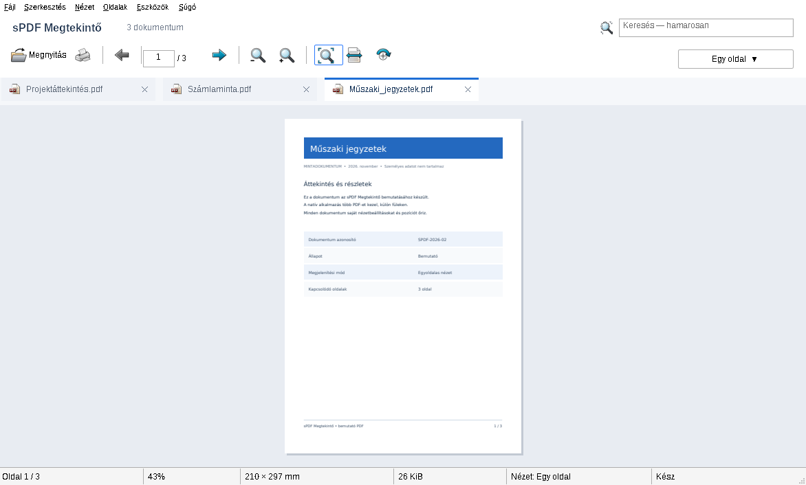

# sPDF Megtekintő

Könnyű, natív C++/Win32 PDF-megtekintő Windows x64 rendszerre. Magyar felület, PDFium motor, KDE Modern Classic ikonok; telepítés és .NET nélkül.

**[Legfrissebb publikált Windows x64 kiadás letöltése – 0.1.0-preview](https://github.com/baloghim/sPDF/releases/download/v0.1.0-preview/sPDF-0.1.0-preview-win-x64.zip)**

A forráskód jelenleg a **0.2.0-preview** mérföldkövet tartalmazza: új, világos főablakot és több dokumentumot kezelő füleket. Az új kiadás a sikeres Windows-ellenőrzések után kerül publikálásra.

**Célrendszer: Windows 10 1607 (14393), x64.** A 0.1.0 kiadás célrendszeri működését a felhasználó visszaigazolta. A 0.2.0 külön célrendszeri tesztet igényel. [Kompatibilitási feljegyzés](docs/PDFium.md).

## A 0.2.0 funkciói

- Rendezett, világos Win32 főablak; magyar Fájl, Szerkesztés, Nézet, Oldalak, Eszközök és Súgó menü.
- 24×24 pixeles, DPI szerint skálázott eredeti KDE Modern Classic ikonok; eszköztippek és aktív nézetállapotok.
- Több PDF megnyitása fájlválasztóval, több fájl behúzásával vagy több parancssori argumentummal.
- Fülek fájlnévvel, teljes útvonalat mutató eszköztippel, kijelölt állapottal és X bezárógombbal; sok fül esetén natív túlcsordulási vezérlő.
- Fülenként megmaradó oldalszám, nagyítás/illesztés, ideiglenes forgatás és görgetési hely.
- Ismételt megnyitáskor a meglévő fül aktiválása; a munkaszál fájlazonosító alapján is felismeri az azonos dokumentumot.
- Egy hibás vagy megszakított jelszókérésű PDF megnyitása nem zárja be a többi dokumentumot.
- Megmaradt PDFium-megjelenítés, lapozás, nagyítás, illesztés, görgetés, Unicode-fájlnév és jelszókérés.
- Hat elkülönített állapotsormező: oldal, nagyítás, papírméret, fájlméret, nézet, műveleti állapot.

A PDFiumot továbbra is **egyetlen munkaszál** használja. A háttérfülek nem renderelnek; fülváltáskor csak az aktív oldal bitképe készül újra. Az eredeti PDF-ek kizárólag olvasásra nyílnak meg. A megjelenítési forgatás nem szerkeszti a dokumentumot.

**Még nem működő, letiltott vezérlők:** keresőmező, nyomtatás, Folyamatos és Oldalrendező nézet; szerkesztés, PDF-export és beállítások. A teljes 1.0 fejlesztése folytatódik a [specifikáció](docs/SPECIFICATION.md) szerint.



A kép a futó Win32 alkalmazás látható felületéről készült Wine/Xvfb alatt, mesterséges mintadokumentumokkal. A Windows címsorát a célrendszer rajzolja.

## Letöltés és használat

A kiadási ZIP-et bontsa ki, és az `sPDF` mappában indítsa az `sPDF.exe` fájlt. A `pdfium.dll` maradjon az EXE mellett. Nincs telepítő, rendszergazdai jogosultságigény, telemetria vagy futás közbeni függőségletöltés.

| Billentyű | Művelet |
|---|---|
| Ctrl+O | Egy vagy több PDF megnyitása |
| Ctrl+W | Aktuális fül bezárása |
| Ctrl+Tab / Ctrl+Shift+Tab | Következő / előző fül |
| PgUp / PgDn | Előző / következő oldal |
| Ctrl+Home / Ctrl+End | Első / utolsó oldal |
| Ctrl++ / Ctrl+- / Ctrl+görgő | Nagyítás / kicsinyítés |
| Enter az oldalszámmezőben | Ugrás az oldalra |
| F1 / Alt+F4 | Billentyűparancsok / kilépés |

## Fordítás és ellenőrzés Windows alatt

Visual Studio 2022 C++ desktop eszközök, Windows SDK, CMake 3.24+, x64 cél szükséges. A Python 3 csak a ZIP ellenőrzéséhez kell. Az ikonok generált erőforrásként a repóban vannak.

```powershell
cmake -S . -B build -A x64 -DBUILD_TESTING=ON
cmake --build build --config Release --parallel 2
ctest --test-dir build -C Release --output-on-failure --no-tests=error
cpack --config build/CPackConfig.cmake -C Release -B dist
python scripts/check-package.py dist/sPDF-0.2.0-preview-win-x64.zip
```

A CMake HTTPS-en tölti le és SHA-256 szerint ellenőrzi a rögzített Windows x64 PDFium archívumot. Offline: `-DSPDF_PDFIUM_ARCHIVE=C:/downloads/pdfium-win-x64.tgz`. Más verziót az ellenőrzés elutasít. A Visual C++ runtime statikusan kerül az EXE-be (`/MT`).

A [Windows x64 preview workflow](https://github.com/baloghim/sPDF/actions/workflows/windows.yml) a `main` ág és a pull requestek ellenőrzését végzi, manuálisan is indítható. A `v0.2.0-preview` címke sikeres fordítás és tesztek után fejlesztői kiadást publikál, ZIP-pel és ellenőrzőösszeggel. A fejlesztői artifactok a sikeres futások **Artifacts** részében is elérhetők.

## Keresztfordítás Linuxon

MinGW-w64 x64 POSIX C++ fordító, windres, CMake és Ninja szükséges.

```sh
cmake -S . -B build-mingw -G Ninja \
  -DCMAKE_TOOLCHAIN_FILE=cmake/mingw-x64.cmake \
  -DCMAKE_BUILD_TYPE=Release -DBUILD_TESTING=ON
cmake --build build-mingw --parallel 2
cpack --config build-mingw/CPackConfig.cmake -B dist
python3 scripts/check-package.py dist/sPDF-0.2.0-preview-win-x64.zip
```

A Windows tesztprogramok Windows vagy Wine környezetet igényelnek; a felületi teszthez grafikus munkamenet is szükséges. A MinGW-build a GCC, C++ és winpthread runtime részeit statikusan linkeli.

## Architektúra és tesztek

- `TabManager` és `DocumentState`: stabil dokumentumazonosítók, fülválasztás és önálló nézetállapotok.
- `PdfDocument` és `PdfiumLibrary`: változatlan, kizárólag olvasható PDFium C API alap.
- `PdfRenderer`: dokumentumtérkép a munkaszálon; sorban tartott megnyitások/bezárások, eldobható aktív renderkérések.
- `DocumentTabBar`: natív tab control bevitel, billentyűzet és túlcsordulás, világos egyedi kirajzolással.
- `MainWindow`: megjelenítés és események, a `spdf_ui` könyvtárban; a PDFiumot nem hívja a felületi szálon.

Nincs lemezes rendergyorsítótár vagy automatikusan eltárolt dokumentumelőzmény. Fülenként csak a dokumentum és a kis nézetállapot marad meg; a teljes felbontású képet csak az aktív fülhöz tartjuk fenn. Egy renderbitkép legfeljebb 48 MiB, ami nem a teljes folyamat memóriakorlátja.

A tesztek valódi PDFium-renderelést, több dokumentum élettartamát, fülváltást, képpontosan visszaálló görgetést, X-es bezárást, hibás és titkosított fájlokat ellenőriznek. [Fejlesztési és tesztjelentés](docs/DEVELOPMENT.md) · [0.2.0 feladat](docs/REQUEST-0.2.0.md).

## Licencek

A PDFium teljes szállítói licenccsomagja a ZIP `licenses/pdfium/LICENSE` fájlja. A KDE Modern Classic ikonok LGPL-3.0-or-later licencűek; eredeti SVG-forrásuk és a szükséges szerzői/licencfájlok a csomag részei. A régi KDE Classic engedélyszövegét és a MinGW runtime licenceit is megőrizzük. Az alkalmazáskódhoz külön projektlicenc még nincs megadva.

Ikonok újragenerálása: `python scripts/generate-icons.py` (CairoSVG 2.8.2 és Pillow). A csomag a használt tizenegy ikont tartalmazza.
